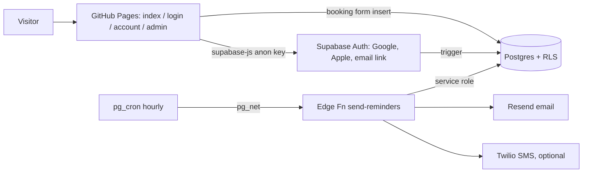

# Namaste Nirvana Massage (Nikesh Pokhrel, South Burlington VT)
Static massage site on GitHub Pages + Supabase (auth, Postgres, Edge Functions, pg_cron). Plain HTML/CSS/vanilla JS, supabase-js 2.45.4 from jsdelivr. No build step.
Repo: BeldangiBoiCode/massage-site. Live: https://beldangiboicode.github.io/massage-site/

## Backend (current, 2026-10-13)
Supabase project "BeldangiBoiCode's Project", ref `aryarbjftnhyayhdlapw` (`supabase-client.js` points at it). Austin owns the backend:
bookings go browser -> edge fn `submit-booking` (validation + IP/phone rate limit) -> `process-bookings` (cron every minute as backup)
-> `appointments` (or declined). Public availability = `busy_slots(d date)` (no names). Time off = `time_off` (admin page `admin-timeoff.html`).
Nikesh's calendar: `calendar-sync` pulls ICS busy times into `external_busy`; `calendar-feed` publishes appointments. Tokens live in `app_settings` (no dashboard secrets).
Auth pages: `auth.html`, `forgot-password.html`, `reset-password.html`, `account-security.html`, `admin-invite.html` (+ `auth.js`, `auth-extra.css`).
Roles: the owner (in `admins`) only uses `admin.html` (phone-first cards: schedule, customers + payments + discounts, reviews, breaks); customers only use `account.html`. Each page redirects the other role away.
Reviews: `review.html` -> edge fn `submit-review` (validation, link/spam block, IP limit) -> `reviews` table (pending until approved on the admin page) -> public sees approved via `public_reviews()`.
Payments (`payments`) and discount codes (`discounts`) are admin-only; discounts are sent through the phone's text/email apps (no sending service needed).
CRM + chat: `admin.html` tabs = Schedule, Clients (profiles, private notes via `customer_notes`, payments, discounts), Chat (table `messages`, realtime, shared `chat.js`/`chat.css`),
Money (appointments made, revenue by month, owed, by massage, CSV export), Reviews, Breaks. Customers chat from `account.html`. RLS: a customer only reads/writes their own `messages`
thread (cannot post as admin or edit admin messages; 30 msgs/hour trigger); admins are in `admins`. Guests without an account are reached by call/text/email.
Opening days/hours come from the `opening_hours` table (the calendar draws only open weekdays); home page reviews strip = `reviews-strip.js` (`review_stats()`, `public_reviews()`).
The booking form no longer inserts into `booking_requests` directly (RLS blocks it). Do not edit `supabase/` or the data logic in `app.js` when restyling.

## Key files
- `index.html` → homepage. Booking form has email + length fields. Header "Sign in" link (`#account-link`) swaps to "My account".
- `styles.css` → all styles. Tokens in `:root`. Sections: site, then Sign in, Account, Admin at the end.
- `decor/cloud.svg`, `decor/trees.svg` → side scenery drawn by `body::before/::after` in styles.css (mirrored on right).
- `header.js` → adds `.scrolled` to `.site-header` after scrolling (solid header). Loaded on every page with a header.
- `app.js` → booking form: day (Sun/Mon) + time slots from `busy_slots()` (9am-8pm, starts on :00/:30 only, hidden 20 min break) → insert `booking_requests`; prefills from profile.
- `supabase-client.js` → SUPABASE_URL + anon key, `sb` client, `currentUser()`, `isAdmin()`, `esc()`.
- `login.html` → Google / Apple OAuth + email magic link → redirects to account.html.
- `account.html` → customer profile edit, their visits (`my_appointments()` rpc) and requests.
- `admin.html` → owner only (`is_admin()`): stats, requests (confirm → appointment), appointments status, clients, reminder log.
- `supabase/migrations/*_init.sql` → tables, RLS, signup trigger, `is_admin()`, `my_appointments()`.
- `supabase/migrations/*_time_slots.sql` → `preferred_time` column, `busy_slots(d)` RPC (anon ok, no PII), `check_booking_slot()` insert trigger (hours + :00/:30 start + overlap + break).
- `supabase/migrations/*_reminder_cron.sql` → pg_cron job hourly → Edge Function. Reads Vault secrets `project_url`, `cron_secret`.
- `supabase/functions/send-reminders/index.ts` → emails/texts appointments in next 24h, logs to `notifications`.

## Data (Supabase, RLS on all)
- `admins`: user_id. Whoever is in here sees everything. Seed by hand after first login.
- `profiles`: id (= auth user), full_name, email, phone, birthday, pressure_pref, health_notes, email_reminders, sms_reminders. Own row or admin.
- `booking_requests`: id, user_id?, name, phone, email, service, duration_min, preferred_date, preferred_time, notes, status(new/confirmed/declined). Public insert; own/admin read.
- `appointments`: id, user_id, booking_id, client_*, service, starts_at, duration_min, price, status, therapist_notes, reminder_sent_at. Admin only; clients via `my_appointments()` (no notes).
- `notifications`: appointment_id, channel(email/sms), sent_to, status, error. Admin read.

## Setup checklist (manual, dashboard)
- Auth → URL config: site URL + redirect `https://beldangiboicode.github.io/massage-site/account.html` and `http://localhost:8000/account.html`.
- Google: Google Cloud OAuth client (web), redirect `https://<ref>.supabase.co/auth/v1/callback` → paste ID/secret in Auth → Providers → Google.
- Apple: needs paid Apple Developer account. Services ID + Sign in with Apple key → Auth → Providers → Apple.
- Edge Fn secrets: CRON_SECRET, RESEND_API_KEY (+ TWILIO_SID/TOKEN/FROM for SMS). Deploy with verify_jwt off.

## Run / deploy
- Local: `cd ~/massage-site && python3 -m http.server 8000` → http://localhost:8000
- Deploy: `git push` to `main`. Pages rebuilds in about 1 minute.

## Gotchas / decisions
- 2026-10-13: Design follows the `web-design` skill. Pine/eucalyptus/mist palette avoids the cream + terracotta spa default.
- 2026-10-13: Auto-push to GitHub `main` after each change, no asking (user said so). Keep replies short and simple.
- 2026-10-13: Only real facts on the site. Real info from user: name, phone (802) 373-9672, namastenirvanamassage@gmail.com, prices 60/90 min = $85/$120 (120 min dropped), hours Sun + Mon 9am-8pm, 2 yrs pro, learning since age 11. No reviews yet.
- 2026-10-13: Membership dropped per user.
- 2026-10-13: Supabase backend added. Email login = magic link (no passwords). Admin = `admins` table, not email match.
- Client health data stays out of GitHub. It only lives in Supabase behind RLS.
