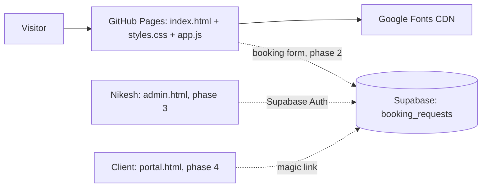

# Stillwater Massage (Nikesh Pokhrel, South Burlington VT)
Static massage therapy site on GitHub Pages. Plain HTML + CSS + vanilla JS, Google Fonts (Instrument Serif, Figtree). No build step.
Repo: BeldangiBoiCode/massage-site. Live: https://beldangiboicode.github.io/massage-site/

## Key files
- `index.html` → page markup: header, hero + facts strip, services/prices, membership band, first visit steps, about Nikesh, booking form + address, footer, mobile book button.
- `styles.css` → all styles. Tokens in `:root` (pine, eucalyptus, mist, sea-glass, linen, stone). Sections in page order.
- `app.js` → booking form validation + confirmation message. Client side only, saves nothing yet.
- `.claude/DIAGRAM.md` → this file.

## Data (planned, not built)
Supabase project not created yet. Planned tables (RLS on all):
- `booking_requests`: id, name, phone, email, service, preferred_date, notes, status(new/confirmed/declined), created_at. Public: insert only.
- `clients`: id, auth_user_id, full_name, phone, email, birthday, created_at. Nikesh: all; client: own row.
- `client_intake`: client_id, health_notes, injuries, pressure_pref, allergies, updated_at. Health data, so never public. Nikesh and the owning client only.
- `appointments`: id, client_id, service, starts_at, duration_min, price, status, therapist_notes.
- `memberships`: client_id, plan, started_at, sessions_banked, status.

## Roadmap
1. Done: static site live (2026-10-13).
2. Booking form → insert into `booking_requests` (supabase-js from pinned CDN, anon key).
3. `admin.html`: Nikesh logs in (Supabase Auth email) and sees requests, clients, appointments.
4. `portal.html`: client magic-link login with their profile, intake form and visit history.

## Run / deploy
- Local: `cd ~/massage-site && python3 -m http.server 8000` → http://localhost:8000
- Deploy: `git push` to `main`. Pages rebuilds in about 1 minute.

## Gotchas / decisions
- 2026-10-13: Design follows the `web-design` skill. Pine/eucalyptus/mist palette avoids the cream + terracotta spa default.
- 2026-10-13: Auto-push to GitHub `main` after each change, no asking (user said so). Keep replies short and simple.
- 2026-10-13: Only real facts on the site. Nothing about Nikesh was found online, so no credentials, years in practice, phone or reviews until the user gives them. Prices and the $79 membership are placeholders the user must confirm.
- 2026-10-13: Membership section is modeled on Massage Envy (monthly session, member rate, rollover).
- Client health data stays out of GitHub. It only lives in Supabase behind RLS.
