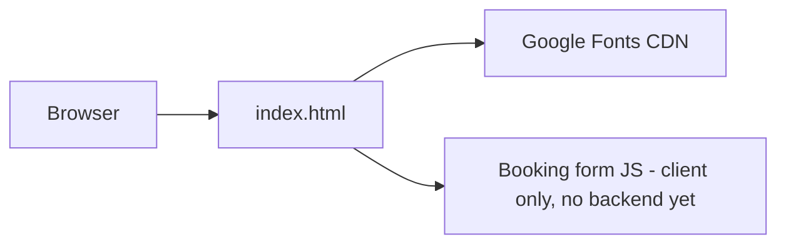

# Stillwater Massage
Static one-page massage therapy site. Plain HTML + CSS + vanilla JS, Google Fonts (Instrument Serif, Figtree).

## Key files
- `index.html` → whole site: header, hero, services/prices, visit steps, about, reviews, booking form, footer. Styles + script inline.

## Data
- None yet. Booking form only shows a confirmation message. Future: Supabase `bookings` table (name, phone, date, service, notes, created_at).

## Run
- `cd ~/massage-site && python3 -m http.server 8000` → http://localhost:8000

## Gotchas / decisions
- 2026-10-13: Made with the frontend-design skill guidance. Pine/eucalyptus/mist palette, chosen to avoid the cream+terracotta spa default.
- 2026-10-13: Placeholder business info (name, address, phone, reviews). Replace before going live.
